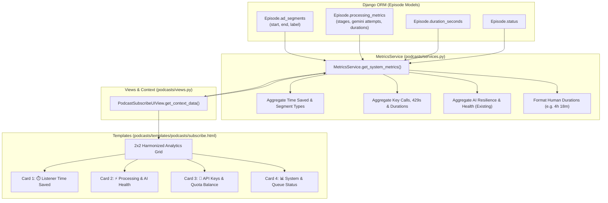

# Design Specification: Dashboard Analytics & 2x2 Metrics Grid

**Date:** 2026-10-15  
**Status:** Draft  
**Target:** Main Podslice UI (`podcasts/templates/podcasts/subscribe.html`, `podcasts/services.py`, `podcasts/views.py`)

---

## 1. Executive Summary & Intent

Podslice currently tracks extensive telemetry for every processed episode in `Episode.processing_metrics` (stage timings, masked API keys, 429 rate limits, fallback models) and `Episode.ad_segments` (start/end timestamps and segment categories). However, the main UI dashboard only surfaces high-level pipeline health (429 recovery, fallback model, clean runs) and a bare-bones system table.

This project delivers **Option 1 (Harmonized 2x2 Grid)** selected during brainstorming:
1. Surfaces **Listener Value & Time Saved** (Category #1: total listening hours saved, ad load percentage, and segment type breakdown).
2. Surfaces **API Key & Quota Distribution** (Category #3: load distribution across configured API keys, per-key 429 rate-limit counts, total audio hours analyzed).
3. Harmonizes existing **Processing & AI Health** and **System & Queue Status** into a unified, responsive 2x2 Bootstrap grid with consistent badges, typography, and card headers.

---

## 2. Architecture & Data Flow

---

## 3. Detailed Requirements & Components

### 3.1 Backend Aggregation Service (`podcasts/services.py`)

`MetricsService.get_system_metrics()` will be extended to calculate:

1. **Listener Time Saved (`time_saved`)**:
   - `total_time_saved_sec`: Sum of `stages["slicing"]["removed_duration_sec"]` (or duration of `ad_segments` for completed episodes).
   - `total_time_saved_formatted`: Formatted string (e.g., `"4h 18m"` or `"25m 10s"`).
   - `total_segments_removed`: Total count of sliced segments across completed episodes.
   - `ad_load_pct`: `(total_time_saved_sec / (total_content_duration_sec + total_time_saved_sec)) * 100`, guarded against zero-division (default `0.0%`).
   - `segment_types_breakdown`: Counter of labels in `ad_segments`:
     - `ads`: count of `ad`, `sponsor`
     - `intros_outros`: count of `intro`, `outro`, `music`
     - `ctas`: count of `cta`, `off-topic`, `other`
     - `pct_ads`, `pct_intros_outros`, `pct_ctas`: Percentage of total segments for the progress bar.

2. **API Keys & Quota Health (`api_keys`)**:
   - Inspects `stages["gemini"]["attempts"]` across all episodes.
   - `keys_distribution`: List of dictionaries for each distinct masked key (`key_masked`):
     - `key_masked`: e.g. `"...3Ds"`
     - `total_calls`: Total invocation attempts on this key.
     - `call_pct`: Percentage of total Gemini calls assigned to this key.
     - `rate_limits`: Number of 429 status attempts for this key.
     - `success_count`: Number of successful calls on this key.
   - `total_audio_analyzed_sec`: Sum of audio duration sent to Gemini.
   - `total_audio_analyzed_formatted`: Formatted string (e.g. `"32.4h"`).
   - `active_keys_count`: Number of distinct keys tracked.

3. **System Status Modernization (`system_status`)**:
   - Retains completed and pending counts, plus total audio ingested.

4. **Zero-Division & Edge-Case Safety**:
   - Every ratio must check if the denominator is `> 0`.
   - Empty databases or un-analyzed episodes must return clean zero values without errors.

---

### 3.2 UI Template Design (`podcasts/templates/podcasts/subscribe.html`)

Replaces the separate, inconsistent `System Status` and `Processing & AI Health` cards with a responsive 2x2 card grid (`
`):

#### Card 1: ⏱️ Listener Time Saved
- **Header**: `⏱️ Listener Time Saved` with badge showing overall `{{ metrics.ad_load_pct }}% Ad Load`.
- **Top Row**: Prominent large number for `{{ metrics.total_time_saved_formatted }}` with subtext *"Total ads & filler removed"* and count of total segments removed.
- **Visual Segment Bar**: A segmented Bootstrap progress bar:
  - Red bar: Sponsor ads
  - Blue bar: Intros/Outros
  - Yellow bar: CTAs/Promos
- **Legend**: Summary counts below the bar.

#### Card 2: ⚡ Processing & AI Health (Existing, unified)
- **Header**: `⚡ Processing & AI Health` with badge showing `{{ metrics.total_episodes_processed }} Processed`.
- **Tiles**: 429 Retry Recovery %, Fallback Model Usage %, Clean Runs %, Unresolved Failures.
- **Footer**: Compact Stage Error Breakdown (`Download (X) · Gemini (Y) · Slicing (Z)`).

#### Card 3: 🔑 API Keys & Quota Balance
- **Header**: `🔑 API Keys & Quota Balance` with badge showing `{{ metrics.active_keys_count }} Keys Active`.
- **Body**: For each key in `metrics.api_keys`:
  - Masked key name (`<code>...3Ds</code>`) and percentage badge.
  - Horizontal progress bar showing usage share.
  - Text: `X calls · Y rate limits`.
- **Footer**: `🎙️ Total Audio Analyzed: {{ metrics.total_audio_analyzed_formatted }}`.

#### Card 4: 📊 System & Queue Status (Refreshed)
- **Header**: `📊 System & Queue Status` with status indicator badge (`Operational`).
- **Body**: 3 stat pillars side-by-side:
  - Completed Episodes (Green)
  - Pending Episodes (Yellow)
  - Total Audio Rehosted (Blue)
- **Footer**: `Last polled: {{ last_polled_time|default:"Never" }}`.

---

## 4. Verification & Testing Plan

1. **Unit Tests for MetricsService (`podcasts/tests/test_metrics.py`)**:
   - Test empty database returns zeroed metrics safely.
   - Test time saved aggregation with multiple episodes and segment categories.
   - Test ad load percentage calculation and zero-division handling.
   - Test API key extraction and 429 tracking from telemetry attempts.
   - Test total audio analyzed duration formatting.
2. **View & Template Rendering Tests (`podcasts/tests/test_views.py`)**:
   - Verify `PodcastSubscribeUIView` context contains the extended metrics dictionary.
   - Verify HTML renders cards, segment progress bars, and key distribution bars correctly.
3. **Full Regression Test Suite**:
   - Run `/home/prmohan/projects/podslice/venv/bin/python manage.py test podcasts` (all 134+ tests pass).
   - Run pylint on modified files.

---

## 5. Constraints

- **DO NOT USE DOCKER**: All tests and execution must run on host venv.
- **No Schema Changes**: Purely aggregated from existing JSON fields.
